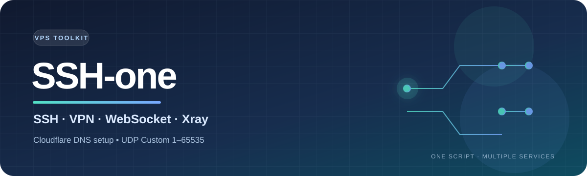

# SSH-one

<div align="center">
  
  <br><br>
  
  
  
  

</div>

---

## สารบัญ

- [ติดตั้งแบบรวดเร็ว](#ติดตั้งแบบรวดเร็ว)
- [สิ่งที่ต้องเตรียม](#สิ่งที่ต้องเตรียม)
- [ค่าที่ตัวติดตั้งถาม](#ค่าที่ตัวติดตั้งถาม)
- [ระบบและบริการที่รองรับ](#ระบบและบริการที่รองรับ)
- [อัปเดตและถอนการติดตั้ง](#อัปเดตและถอนการติดตั้ง)
- [ข้อจำกัดที่ควรรู้](#ข้อจำกัดที่ควรรู้)

## ติดตั้งแบบรวดเร็ว

> **ใช้กับ VPS ใหม่เท่านั้น** ไม่รองรับอัปเกรดหรือติดตั้งต่อจากงานที่ค้าง

1. แตก ZIP แล้วอัปโหลด **ไฟล์และโฟลเดอร์ข้างใน** ไว้ที่รากของ repository อย่าวางในโฟลเดอร์ <code>SSH-one-v20</code>
2. ใช้ repository ชื่อ <code>Phechr-2025/SSH-one</code> และ branch <code>main</code> หรือแก้ชื่อในคำสั่งติดตั้งให้ตรง repository ของคุณ
3. เข้า VPS ด้วยบัญชี <code>root</code> แล้วรัน:

    ```bash
    bash <(curl -fsSL https://raw.githubusercontent.com/Phechr-2025/SSH-one/main/install.sh) Phechr-2025 SSH-one main
    ```

4. กรอก Host/subdomain ที่มี DNS A record ชี้มายัง Public IPv4 ของ VPS แล้วกรอก Cloudflare API Token เมื่อระบบถาม

เมื่อตรวจ SSH ผ่าน จะนับถอยหลัง 10 วินาทีแล้ว reboot อัตโนมัติ หากไม่ผ่านจะหยุดและบันทึกสาเหตุที่ <code>/root/log-install.txt</code> ระบบยังตั้ง reboot ประจำวันเวลา 05:00 (GMT+8)

ค่าเริ่มต้นจะติดตั้ง UDP Custom อัตโนมัติ หลังเข้า VPS แล้วใช้คำสั่ง <code>menu</code> และเลือกข้อ 1 เพื่อเปิด/ปรับพอร์ต ตรวจสถานะ เปลี่ยนพอร์ต listener จัดการบัญชี หรือติดตั้ง/ซ่อม UDP Custom ตัวติดตั้งตรวจว่าเมนูถูกลงเป็นคำสั่งที่เรียกใช้ได้ก่อนจบ; หากชื่อ <code>menu</code> ชนกับคำสั่งอื่น ให้ใช้ <code>/usr/bin/menu</code>

หากย้าย repository ให้แก้ <code>repository.conf</code> และ owner/repository/branch ในคำสั่งติดตั้ง

## อัปเดตและถอนการติดตั้ง

ถ้าเครื่องเดิมยังเป็น v17 ให้เริ่มอัปเดตด้วยตัว bootstrap v20 นี้ (ถ้าเปลี่ยน repository ให้เปลี่ยน URL ให้ตรงด้วย):

```bash
bash <(curl -fsSL https://raw.githubusercontent.com/Phechr-2025/SSH-one/main/update/updatemenu.sh)
```

ถ้า v18 หยุดด้วยข้อความ <code>a pre-existing command has no safe backup: /usr/bin/about</code> ให้แก้โค้ด v20 ขึ้น repository ก่อน แล้วรันคำสั่งกู้คืนนี้บน VPS เดิม คำสั่งนี้ลงทะเบียนคำสั่ง/เมนูที่ขาดต่อจากจุดติดตั้งเดิม โดยไม่ติดตั้งบริการซ้ำ:

```bash
bash <(curl -fsSL https://raw.githubusercontent.com/Phechr-2025/SSH-one/main/recover-v18.sh)
```

- อัปเดตจากเมนูหลักข้อ **21** หรือรัน <code>ssh-one-update</code> ด้วย root ตัวอัปเดตดาวน์โหลด ZIP จาก repository ที่บันทึกไว้ ตรวจ version และ syntax ของสคริปต์ แล้วเตรียมไฟล์ทั้งหมดก่อนสลับใช้งาน หากขั้นตอนแทนไฟล์หรือบันทึกทะเบียนไม่สำเร็จ จะย้อนคืนไฟล์ที่เปลี่ยนไป
- อัปเดตไฟล์คำสั่งและเมนูที่ระบุใน <code>update/managed-files.tsv</code> รวมถึงตัวอัปเดต/ถอนติดตั้ง บันทึก checksum ไว้ใช้ตรวจไฟล์ค้างและคืนไฟล์เดิมที่มีอยู่ก่อนติดตั้ง หากเครื่อง v17 ไม่มีคำสั่ง <code>menu</code> ให้ใช้ bootstrap ด้านบนก่อน แล้วลอง <code>/usr/bin/menu</code>
- การอัปเดตนี้ไม่เปลี่ยนบัญชี/ไฟล์ตั้งค่าบริการ, firewall, แพ็กเกจระบบ หรือไบนารี VPN ที่ดาวน์โหลดจาก upstream แยกต่างหาก
- ถอนจากเมนูหลักข้อ **26** หรือรัน <code>ssh-one-uninstall</code> ด้วย root แล้วพิมพ์ <code>UNINSTALL</code> สคริปต์จะหยุดเฉพาะ service unit ที่ตรวจพบว่าเรียกไฟล์ของ SSH-one และลบไฟล์ที่ checksum ยังตรงกับไฟล์ที่ติดตั้งไว้ หากมีไฟล์เดิมอยู่ก่อนจะคืนไฟล์นั้น
- การถอนลบข้อมูล/บัญชีใน <code>/etc/xray</code>, <code>/etc/trojan-go</code>, <code>/etc/wireguard</code>, <code>/root/udp</code> และ <code>/var/lib/crot</code> ซึ่งเป็นโฟลเดอร์ข้อมูลของบริการชุดนี้ สำรองข้อมูลก่อนถอน
- เพื่อรักษาการเข้าถึง VPS ระบบจะเก็บ OpenSSH, แพ็กเกจ apt, Linux user ที่ไม่บันทึกเจ้าของ, กฎ firewall ที่ไม่มีป้าย SSH-one และไฟล์ที่ถูกแก้หลังติดตั้งไว้ การถอนจึงไม่สามารถลบรายการเหล่านี้โดยเดาได้อย่างปลอดภัย

### ถ้า v13 หยุดที่ `/etc/set.sh`

อย่ารันตัวติดตั้งซ้ำบน VPS เดิม เพราะบริการส่วนใหญ่ติดตั้งไปแล้ว ใช้คำสั่งนี้ใน shell ที่ยังเปิดอยู่:

```bash
curl -fsSL -o /root/ssh-one-recover-v13.sh https://raw.githubusercontent.com/Phechr-2025/SSH-one/main/recover-v13.sh && bash /root/ssh-one-recover-v13.sh
```

สคริปต์จะปิด unit `autosett` ที่เสีย ตรวจ SSH และพอร์ต 22/2253 ก่อน หากผ่านจะนับ 10 วินาทีแล้ว reboot; หากไม่ผ่านจะหยุดและบันทึกสาเหตุใน <code>/root/log-install.txt</code>

## สิ่งที่ต้องเตรียม

- VPS ใหม่ที่ใช้ **Ubuntu 20.04 x86_64**, มี <code>systemd</code> และเข้าใช้งานด้วย <code>root</code>
- IPv4 สาธารณะ และพอร์ตที่ต้องใช้เปิดผ่าน firewall/security group ของผู้ให้บริการ VPS
- โดเมนใน Cloudflare ที่มี Zone สถานะ **Active**, ใช้ nameserver ของ Zone นั้นจริง และมี DNS-only A record ของ Host ชี้มายัง Public IPv4 ของ VPS
- Cloudflare API Token จากบัญชีเดียวกับ Zone ที่มีสิทธิ์ **Zone:Read** และ **DNS:Write** เฉพาะ Zone ที่ใช้งาน
- เชื่อมต่อ VPS ผ่าน SSH ได้ก่อนเริ่มติดตั้ง

> ต้องมีรหัส root ที่ใช้ได้หรือ SSH key และเปิด TCP 22/2253 ใน firewall ของผู้ให้บริการ หาก root ถูกล็อก ให้ตั้งค่าผ่าน console ก่อนใช้

> รองรับเฉพาะ Ubuntu 20.04 x86_64; Debian, ARM และ Ubuntu รุ่นอื่นยังไม่รับรอง

## ค่าที่ตัวติดตั้งถาม

ตัวติดตั้งถาม Host ก่อน ตรวจ DNS กับ IP สาธารณะของ VPS แล้วจึงขอ Cloudflare API Token และเริ่มติดตั้งบริการ

### 1. Host/subdomain

ชื่อ DNS ที่จะใช้เชื่อมต่อ เช่น <code>ssh1.mydomain.com</code>

- ใช้ชื่อเต็มในโดเมน Cloudflare เช่น <code>ssh1.mydomain.com</code>; ไม่ต้องใส่ <code>https://</code>, พอร์ต หรือ IP
- สร้าง DNS-only A record ให้ Host ชี้มายัง Public IPv4 ของ VPS ก่อนติดตั้ง

หลังกรอก Host ตัวติดตั้งตรวจ public DNS ว่า A record ชี้มายัง VPS จริง หากไม่ตรงจะแสดง IP ที่คาดหวังกับค่าที่พบ แล้วให้แก้ DNS และกดตรวจซ้ำ หรือเปลี่ยน Host ก่อนติดตั้งต่อ หาก VPS ติดต่อ public DNS ไม่ได้จะแจ้งให้ตรวจ outbound HTTPS ก่อนลองใหม่ เมื่อผ่านแล้ว Cloudflare API จะยืนยันและคง A record แบบ DNS only ไว้ที่ IP เดียวกัน หากเปิด Cloudflare Proxy หรือมี CNAME/record ชนกัน การตรวจหรือตั้งค่าอาจไม่ผ่าน

### 2. Cloudflare API Token

Token ใช้จัดการ DNS ผ่าน Cloudflare API ไม่ใช่รหัสผ่านบัญชีหรือ Global API Key ต้องสร้าง/ใช้ Token จากบัญชี Cloudflare ที่จัดการ Zone ของโดเมน Host นี้ หากมีหลายบัญชี ให้เลือกบัญชีที่มี DNS zone และ record ของโดเมนจริง

วิธีสร้าง:

1. ไปที่ **My Profile → API Tokens → Create Token**
2. เลือก template **Edit Zone DNS** เพื่อให้สิทธิ์ **DNS Write** แล้วเพิ่ม **Zone Read** หากยังไม่มี
3. จำกัด Zone Resources ให้เฉพาะโดเมนที่จะใช้ แล้วสร้างและคัดลอก Token

วาง Token ในช่องติดตั้ง (ตัวอักษรถูกซ่อนขณะพิมพ์) อย่าเผยแพร่ Token ตัวติดตั้งจะแสดงชื่อและ ID ของบัญชีที่ API ใช้เข้าถึง Zone ตรวจว่า nameserver สาธารณะตรงกับ Zone ในบัญชีนั้น และยืนยันว่า A record แบบ DNS only ชี้ไปยัง Public IPv4 ของ VPS หาก Token เข้าถึง Zone ผิดหรือไม่มีสิทธิ์ ระบบจะแจ้งให้ตรวจบัญชีและสิทธิ์ก่อนติดตั้งบริการ

- [คู่มือเพิ่มโดเมนและตั้ง nameserver ใน Cloudflare](https://developers.cloudflare.com/fundamentals/manage-domains/add-site/)
- [คู่มือสร้าง API Token](https://developers.cloudflare.com/fundamentals/api/get-started/create-token/)
- [สิทธิ์และ template ของ API Token](https://developers.cloudflare.com/fundamentals/api/reference/template/)

### ตัวอย่าง

ตัวอย่างเมื่อโดเมน <code>mydomain.com</code> อยู่ใน Cloudflare:

```text
Host/subdomain: ssh1.mydomain.com
Cloudflare API Token: [วาง Token ที่สร้าง]
```

ไม่ต้องกรอก Zone หรือ IP แต่ต้องตั้ง DNS-only A record ให้ชี้มายัง VPS ก่อน ตัวติดตั้งตรวจ DNS สาธารณะก่อนขอ Token แล้วใช้ Token ตรวจและยืนยัน record ผ่าน Cloudflare API

## ระบบและบริการที่รองรับ

### ระบบปฏิบัติการ

| รายการ | สถานะ |
| --- | --- |
| Ubuntu 20.04 x86_64 + systemd | รองรับ |
| Debian, Ubuntu รุ่นอื่น, ARM | ยังไม่รับรอง |

Ubuntu 20.04 สิ้นสุด Standard Security Maintenance แล้ว หากนำไปใช้งานต่อควรเปิด Ubuntu Pro/ESM หรือใช้ระบบปฏิบัติการที่ยังได้รับอัปเดตความปลอดภัย ([รายละเอียด lifecycle](https://ubuntu.com/20-04))

### บริการและพอร์ตเริ่มต้น

พอร์ตเริ่มต้นอาจเปลี่ยนได้ ตรวจ <code>/root/log-install.txt</code> และสถานะ service ก่อนใช้งาน

| บริการ | พอร์ต/โปรโตคอล |
| --- | --- |
| OpenSSH | TCP 22, 2253 |
| Dropbear | TCP 109, 143, 1153 |
| OpenVPN | TCP 1194, UDP 2200, SSL 990 |
| Stunnel | TCP 443, 445 |
| SSH WebSocket | TLS 443, HTTP 8880 |
| BadVPN | TCP 7100, 7200, 7300 |
| WireGuard | UDP 7070 |
| L2TP/IPsec, PPTP | UDP 1701, TCP 1732 |
| SSTP | TCP 444 |
| Shadowsocks-R | TCP 1443–1543 |
| Shadowsocks OBFS | TLS 2443–2543, HTTP 3443–3543 |
| Xray VMess | TLS 8443, non-TLS 80 |
| Xray VLESS | TLS 8444, non-TLS 81 |
| Xray Trojan, TrojanGo | TCP 2083, 2087 |
| OHP | TCP 8181, 8282, 8383 |
| UDP Custom | ช่วง UDP ใน firewall เริ่มต้น 1–65535 (ปรับได้); listener เริ่มต้น UDP 36712 (เปลี่ยนได้) |

ค่าเริ่มต้นตัวติดตั้งเปิดช่วง UDP <code>1–65535</code> ใน UFW เมื่อ UFW ทำงาน และปรับช่วงได้จาก <code>menu → 1 → Open port(s)</code> โดยเลือก UDP, TCP หรือทั้งคู่ หากเว้นช่อง Protocol และ Ports ระบบใช้ UDP กับช่วง <code>1–65535</code> เป็นค่าเริ่มต้น

ตัวบริการ UDP Custom ฟังอยู่ที่พอร์ตเดียว ค่าเริ่มต้นคือ <code>36712/UDP</code>; เปลี่ยน listener เป็นพอร์ตว่างอื่นในช่วง <code>1–65535</code> ได้จาก <code>menu → 1 → Change UDP Custom listener port</code> หลังเปลี่ยนให้เปิดพอร์ตนั้นใน firewall ของ VPS และ firewall/security group ของผู้ให้บริการด้วย การเปิดกฎ firewall เพียงอย่างเดียวไม่ได้ทำให้มีบริการฟังพอร์ตนั้น ช่วง <code>1–65535</code> กว้างและอาจชนกับบริการอื่น

## ข้อจำกัดที่ควรรู้

- **SlowDNS** ไม่ติดตั้ง: upstream อ้างไฟล์ที่ไม่มีและมีคำสั่งลบไฟล์ใน <code>/root</code>
- **gRPC** ปิดไว้ตาม upstream
- **Squid** ไม่ติดตั้งในชุดต้นฉบับ
- **OHP** ต้องมี HTTP proxy ที่ <code>127.0.0.1:3128</code>
- บริการเดิมบางตัวขึ้นกับ upstream จึงอาจใช้ไม่ได้ในบาง VPS
- สำรองข้อมูลก่อนติดตั้ง หากล้มเหลวให้ตรวจ <code>/root/log-install.txt</code>; ไม่รองรับติดตั้งต่ออย่างปลอดภัย
- หาก Token/credential เคยอยู่ใน Git history ให้ revoke แล้วสร้างใหม่
- Backup/restore ต้องตั้ง remote ชื่อ <code>dr</code> ด้วย <code>rclone config</code>
